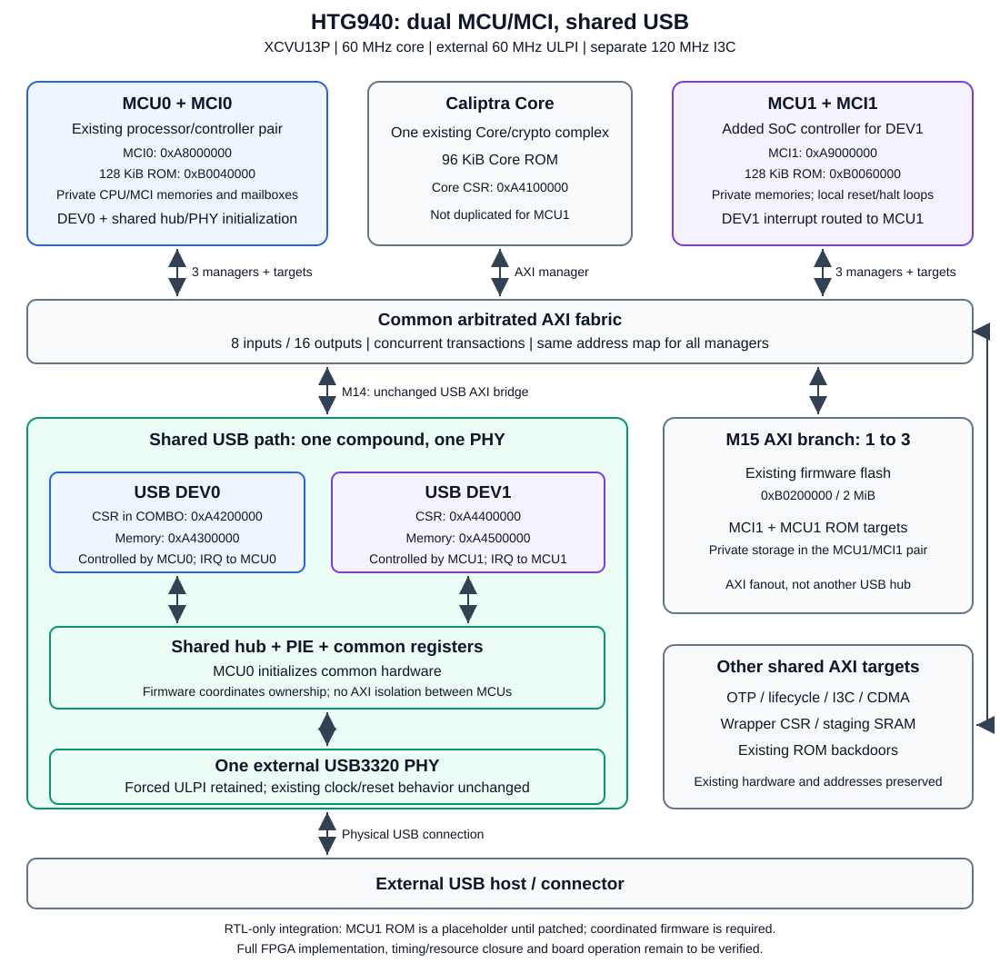

<!-- SPDX-License-Identifier: Apache-2.0 -->

# HTG940 dual-MCU FPGA guide

Target: **HiTech Global HTG-940, XCVU13P-FHGB2104-3-E**.
Branch: **`htg940_dual_mcu_shared_usb`**.
The FPGA flow uses a 60 MHz core clock, an external 60 MHz ULPI clock,
a separate cascaded 120 MHz I3C clock and two ILAs.

## Block diagram



### Ownership and shared resources

| Block | Role |
| --- | --- |
| MCU0 / MCI0 | Existing pair; firmware initializes the shared hub/PHY and operates USB DEV0 |
| MCU1 / MCI1 | Added SoC-controller pair; firmware operates USB DEV1 without repeating shared initialization |
| Caliptra Core | One existing Core/crypto complex; no second Core |
| USB | One compound with DEV0, DEV1, shared hub/PIE and one external USB3320 PHY |
| AXI | Shared arbitrated fabric; both MCUs may issue transactions concurrently |
| OTP / lifecycle / I3C | Existing shared hardware, not duplicated for MCU1 |

MCU1 receives DEV1's USB interrupt and has private CPU memories, MCI SRAM,
ROM-patch SRAM, mailboxes and a 128 KiB ROM. Its reset/halt loops are local.
MCI1 observes the real shared lifecycle/OTP completion and status; its
initialization, reset, zeroization and lifecycle outputs do not control the
shared hardware or the existing Core.

The main SmartConnect has eight inputs and sixteen outputs. MCU1's IFU,
LSU and system-bus managers use S05, S06 and S07. An added 1-to-3 branch on
M15 serves existing firmware flash, MCI1 and MCU1 ROM. The USB bridge and
its four subordinate interfaces are unchanged.

**Ownership is a firmware contract, not an AXI access-control boundary.**
Both MCUs can physically address the shared USB hardware. MCU0 firmware
must leave DEV1 available; MCU1 firmware must not reset or disconnect the
common hub/PHY. This branch does not supply that coordinated firmware.

## Prepare sources

Requirements: Git, Python 3, Tcl and Vivado **2025.1** with support and
licenses for the target device. The build scheduler, if used, is external
to this repository.

```sh
git clone --recursive --branch htg940_dual_mcu_shared_usb \
  https://github.com/faydn23/caliptra-mcu-sw.git
cd caliptra-mcu-sw
python3 hw/fpga/htg940/prepare_sources.py --apply
python3 hw/fpga/htg940/prepare_sources.py --check
```

The helper verifies the recorded recursive pins and applies the supplied
dependency patches. Follow its explicit fetch instructions if a pinned
commit is unavailable. Do not update submodules again after preparation.
Dependency repositories are not modified or pushed by publishing this branch.

Supply a **writable external directory** containing:

| File | Requirement |
| --- | --- |
| `caliptra_rom.bin` | 98,304-byte Core ROM |
| `mcu_rom.bin` | 131,072-byte MCU0 ROM |
| `flash_image.bin` | Flash payload fitting the 2 MiB flash memory |

The build regenerates MEM/COE files in that directory. Firmware binaries,
bitstreams, MMI/LTX files and generated projects are not distributed here.
MCU1's build-time ROM is a zero-filled MMI placeholder, not a boot image.

## Build the dual-MCU, forced-ULPI profile

The dual-MCU option does not change ULPI selection. Keep the existing
forced-ULPI profile by selecting **both** `DUAL_MCU` and `FORCE_ULPI_MODE`.
Use a fresh build name; existing outputs are never overwritten.

After sourcing the Vivado environment, run from the repository root:

```sh
vivado -mode batch \
  -log htg940_dual_mcu_shared_usb.log \
  -journal htg940_dual_mcu_shared_usb.jou \
  -source hw/fpga/htg940/run_full.tcl \
  -tclargs DUAL_MCU FORCE_ULPI_MODE \
  BUILD_NAME=build_full_dual_mcu_shared_usb \
  FW_IMAGE_DIR=/absolute/path/to/writable/firmware IMPLEMENT
```

If your environment requires a scheduler, submit this command using your
normal project/license settings. Repository preparation does not submit
jobs or program hardware.

Without `DUAL_MCU`, the original single-pair profile remains available.
`SOFTWARE_ULPI_STARTUP` is a separate optional experiment and must not be
combined with `FORCE_ULPI_MODE`. See the [profile reference](htg940_usb_min_ila/README.txt).

Expected outputs, after a successful full implementation:

```text
hw/fpga/htg940_usb_min_ila/build_full_dual_mcu_shared_usb/
  caliptra_htg940_project.runs/impl_1/
    htg940_board_top.bit
    htg940_board_top.mmi
    htg940_usb_dual_ila.ltx
```

Always use BIT/MMI/LTX from the same implementation. Resume/restart must
use the same MCU-count and ULPI flags as the original build.

## Address map

All eight AXI managers see the same map. Existing addresses are preserved.

| Target | Base | Window |
| --- | --- | --- |
| FPGA wrapper CSR | `0xA4010000` | 16 KiB |
| Subsystem I3C / spare I3C | `0xA4030000` / `0xA4032000` | 8 KiB each |
| Lifecycle controller | `0xA4040000` | 8 KiB |
| OTP CSR | `0xA4060000` | 8 KiB |
| Xilinx I3C | `0xA4080000` | 4 KiB |
| CDMA control | `0xA4081000` | 4 KiB |
| Caliptra Core CSR | `0xA4100000` | 1 MiB |
| USB COMBO: DEV0 CSR, hub and recovery | `0xA4200000` | 1 MiB |
| USB DEV0 memory | `0xA4300000` | 1 MiB |
| USB DEV1 CSR | `0xA4400000` | 1 MiB |
| USB DEV1 memory | `0xA4500000` | 1 MiB |
| MCI0 | `0xA8000000` | 16 MiB |
| **MCI1** | **`0xA9000000`** | **16 MiB** |
| Core ROM backdoor | `0xB0000000` | 128 KiB AXI window; 96 KiB ROM |
| MCU0 ROM backdoor | `0xB0020000` | 128 KiB |
| MCU0 ROM / reset vector | `0xB0040000` | 128 KiB |
| **MCU1 ROM / reset vector** | **`0xB0060000`** | **128 KiB** |
| OTP RAM | `0xB0080000` | 64 KiB |
| Staging SRAM | `0xB00C0000` | 256 KiB |
| Firmware flash | `0xB0200000` | 2 MiB |

MCU1 AXI USER is `2`; MCI1 SoC-configuration USER is `1`.
MCU1 firmware must use its own MCI base and reset vector.

## Patch ROMs before programming

`--mcu-rom` retains its existing **MCU0** meaning.
The added **`--mcu1-rom`** selects the distinct `mcu1_rom` MMI instance.
Core and MCU0 MMI names are unchanged.

First validate your supplied images and matching implementation artifacts:

```sh
python3 hw/fpga/htg940_update_roms.py \
  --bit /absolute/path/to/htg940_board_top.bit \
  --mmi /absolute/path/to/htg940_board_top.mmi \
  --core-rom /absolute/path/to/core.bin \
  --mcu-rom /absolute/path/to/mcu0.bin \
  --mcu1-rom /absolute/path/to/mcu1.bin \
  --out /absolute/path/to/new_three_rom_image.bit --dry-run
```

Remove `--dry-run` to invoke `updatemem` and create the new bitstream.
Core ROM capacity is 96 KiB; each MCU ROM capacity is 128 KiB. BIN and
64-bit MEM inputs are accepted; short inputs are zero-padded. ELF is not
accepted directly. Existing inputs and output files are not overwritten.
Validation cannot establish BIT/MMI provenance or firmware correctness.

Do not program the zero-filled MCU1 placeholder as if it were usable firmware.
Three-ROM patching alone does not implement the required firmware coordination.

## Checks and qualification

```sh
python3 hw/fpga/htg940/prepare_sources.py --check
python3 -m unittest hw.fpga.htg940.test_fpga_integration
python3 -m unittest discover -s hw/fpga/htg940_usb_min_ila -p 'test_*.py'
```

The prepared RTL was checked with focused integration tests, SystemVerilog
elaboration and Vivado block-design/address-map validation. The SV check
does not elaborate the unchanged mixed-language USB VHDL implementation.
Actual elaboration confirmed two MCUs, two MCIs, one Core and one USB wrapper.
These checks do **not** establish synthesis success, resource/timing closure,
three-ROM MMI generation, enumeration or board-level recovery.

The [pin constraints](constraints/htg940_board_nxp.xdc) and
[board wrapper](board/htg940_board_top.sv) define the board boundary.
Always use the generated LTX matching the programmed BIT. CPU JTAG taps
remain inactive in the current board wrapper; FPGA configuration JTAG is
separate. MCU1 UART logging is not added by this RTL profile.
